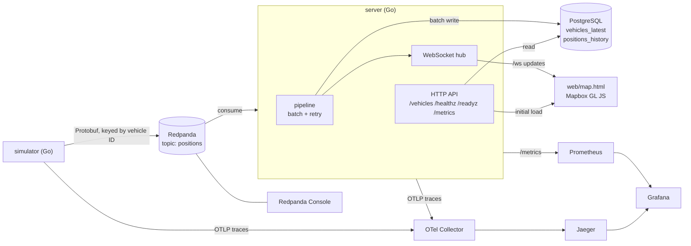

# Fleet Pulse

A real-time fleet telemetry pipeline built to be operated, not just demoed. Simulated vehicles stream GPS positions through Redpanda into PostgreSQL and onto a live Mapbox map. SLOs, burn-rate alerts, end-to-end tracing, failure drills and a capacity report show how it holds up and where it breaks.

## Architecture



The server writes a batch to Postgres first and only then pushes it to browsers, so the live feed never shows a position that isn't stored. The WebSocket broadcast is non-blocking: a slow browser is dropped rather than allowed to stall the write loop.

| Component | Role |
| --- | --- |
| `simulator` | One goroutine per vehicle doing a random walk in a city bounding box; publishes Protobuf to `positions`, keyed by vehicle ID |
| Redpanda | Kafka-compatible broker; `positions` has 6 partitions and 1 h retention |
| `server` | Consumes `positions` in a consumer group, batch-writes to Postgres (retrying failed writes with backoff), pushes each batch's newest position per vehicle over WebSocket, serves `GET /vehicles`, `/metrics`, `/healthz` and `/readyz`, and degrades gracefully under overload |
| PostgreSQL | `vehicles_latest` (current state per vehicle, never rolled back by a late message) and `positions_history` (every reading, deduplicated on `vehicle_id, event_ts`) |
| `web/map.html` | Mapbox GL JS with clustering; vehicles silent for more than 60 s turn grey |
| Prometheus, Grafana | Metrics, recording rules, burn-rate alerts and dashboards provisioned as code |
| OTel Collector, Jaeger | Receive and store traces |
| Redpanda Console | Web UI for inspecting topics and consumer lag |

**Stack:** Go · Redpanda (franz-go) · PostgreSQL (pgx) · Protobuf · Mapbox GL JS · Prometheus · Grafana · OpenTelemetry · Jaeger · Docker Compose

## Quick start

**Prerequisites:** Docker Desktop or OrbStack (about 4 GB RAM free), Go 1.24+, and a free [Mapbox access token](https://account.mapbox.com/access-tokens/) set as `MAPBOX_TOKEN` (see `.env.example`).

```bash
make up        # build and start the whole stack and create the topic
make logs      # follow server and simulator logs
make psql      # open a SQL shell on the fleet database
make down      # stop everything and delete its data
```

Run `make help` to list every target. Other useful ones: `make check` (format, vet, tests), `make sim VEHICLES=200` (restart the simulator with a different fleet size) and `make proto` (regenerate Protobuf code).

| Service | URL | Credentials |
| --- | --- | --- |
| Live map | http://localhost:8080 | none |
| Grafana | http://localhost:3000 | none |
| Prometheus | http://localhost:9090 | none |
| Jaeger | http://localhost:16686 | none |
| Redpanda Console | http://localhost:8081 | none |
| PostgreSQL | `localhost:5432`, database `fleet` | `fleet` / `fleet` (local only) |
| Kafka API (host clients) | `localhost:19092` | none |

The server also exposes `GET /vehicles` (current position of every vehicle), `/ws` (live updates), `/healthz`, `/readyz` and `/metrics` on port 8080. Each WebSocket message is a JSON array of vehicles in the same shape as `/vehicles`; a client loads `/vehicles` first, then merges updates by `id`, keeping the entry with the newer `event_time`. The socket accepts same-origin handshakes only.

## SLOs

| SLO | SLI | Target | Window |
| --- | --- | --- | --- |
| Freshness | Updates pushed ≤ 2 s after the vehicle's event timestamp ÷ all updates | 99% | 7 days |
| API availability | Successful `GET /vehicles` and WebSocket upgrades ÷ attempts | 99.5% | 7 days |

Alerts use multi-window, multi-burn-rate rules: page at 14.4× (1 h and 5 m), ticket at 6× (6 h and 30 m). Every alert links to a runbook.

## Observability

- **Metrics:** RED per endpoint, a freshness histogram, consumer lag per partition, messages/s, Postgres write latency and Go runtime stats.
- **Traces:** one trace follows a message from simulator → Redpanda → server → Postgres → WebSocket, with context carried in Kafka record headers.
- **Logs:** structured JSON on stdout with `trace_id` on every line.
- **Correlation:** freshness exemplars link to traces in Jaeger, and each trace's ID appears in the matching log lines.

Grafana dashboards (SLO overview, pipeline, service health) are provisioned as code.

## Failure drills

Each drill has a runbook and a postmortem recording time to detect and time to recover. Recovery is measured from removing the fault until consumer lag is back to baseline.

| Drill | Fault |
| --- | --- |
| Consumer kill | `docker kill` the server mid-stream |
| Postgres outage | Pause the database for 2 minutes |
| Redpanda outage | Stop the broker for 2 minutes |
| Topic flood | Run the simulator at 10× its normal rate |

## Capacity

A load ramp steps from 1,000 to 50,000 vehicles and records throughput, lag, freshness and resource use at each step. The capacity report states messages/s per server instance, the resource that saturates first, and how the system degrades past that point. The server also scales horizontally: additional instances join the consumer group and share the partitions.

## Repo layout

```
cmd/          simulator and server binaries (wiring only)
internal/     shared packages: config, kafka, store, pipeline, feed, ws, httpapi, sim, telemetry, pb
proto/        Protobuf schema
web/          map page
deploy/       Docker Compose, Dockerfile and per-container config
docs/         runbooks, postmortems, capacity report, decisions
scripts/      drill and load scripts
Makefile
```

## License

MIT
